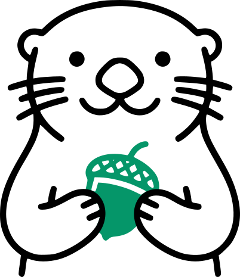
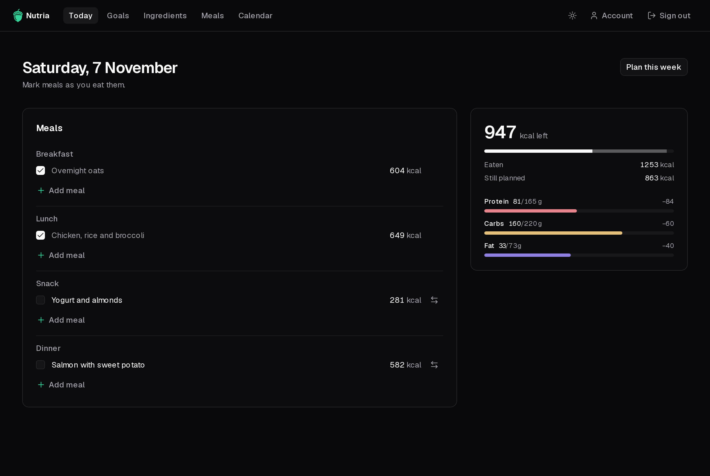

<p align="center">
  <picture>
    <source media="(prefers-color-scheme: dark)" srcset="docs/src/assets/nutria-dark.svg">
    
  </picture>
</p>

<h1 align="center">Nutria</h1>

<p align="center">
  <a href="https://github.com/alvfdz/nutria/releases/latest"></a>
  <a href="https://github.com/alvfdz/nutria/actions/workflows/ci.yml?query=branch%3Amain"></a>
  <a href="LICENSE"></a>
  <a href="https://alvfdz.github.io/nutria/"></a>
</p>

Plan what you eat, not just log it. Nutria is a self-hosted macro tracker and
meal planner, free and open source.



- **Set your budget**: daily calories and a protein/carbs/fat split, divided
  across your meals.
- **Build your library**: ingredients, by hand or imported from Open Food
  Facts, combined into reusable meals.
- **Plan your week**: put meals on a calendar and see each slot's budget
  before you eat.
- **Tick off today**: mark what you ate, swap what changed, see what's left.

> [!IMPORTANT]
> Nutria is a planning tool, not medical advice. If you manage your diet for a
> health condition, follow your doctor or dietitian.

**[Documentation](https://alvfdz.github.io/nutria/)**:
[deploy it](https://alvfdz.github.io/nutria/deployment/self-hosting/) ·
[user guide](https://alvfdz.github.io/nutria/guide/first-run/)

## Quick start

With Docker and Docker Compose:

```bash
git clone https://github.com/alvfdz/nutria.git
cd nutria
cp .env.example .env   # set POSTGRES_PASSWORD, BETTER_AUTH_SECRET and BETTER_AUTH_URL
docker compose up -d --build --wait
```

Then open [http://localhost:3000](http://localhost:3000). The
[self-hosting guide](https://alvfdz.github.io/nutria/deployment/self-hosting/)
explains each setting, reverse proxies and updates.

## Contributing

Built with Next.js, TypeScript, Tailwind CSS, shadcn/ui and PostgreSQL via
Prisma. [`CONTRIBUTING.md`](CONTRIBUTING.md) covers the development setup and
workflow, and [`CODE_OF_CONDUCT.md`](CODE_OF_CONDUCT.md) what to expect from
a hobby project. [`docs/vision.md`](docs/vision.md) sets the product direction, and
[`docs/design-system.md`](docs/design-system.md) sets the look of every screen.

## License

Nutria's code is released under the [MIT License](LICENSE). It is provided "as
is", with no warranty and no support of any kind.

Third-party code copied into this repository, and the fonts bundled at build
time, keep their own licenses: see
[`THIRD_PARTY_NOTICES.md`](THIRD_PARTY_NOTICES.md).

### Food data

The MIT License does not cover food data. Food search results come from
[Open Food Facts](https://world.openfoodfacts.org) contributors. The database is
available under the Open Database License, its individual contents under the
Database Contents License, and product images under Creative Commons
Attribution-ShareAlike. See their
[terms of use](https://world.openfoodfacts.org/terms-of-use).

This data may contain errors and must not be used for medical purposes. Nutria
is not medical advice.
