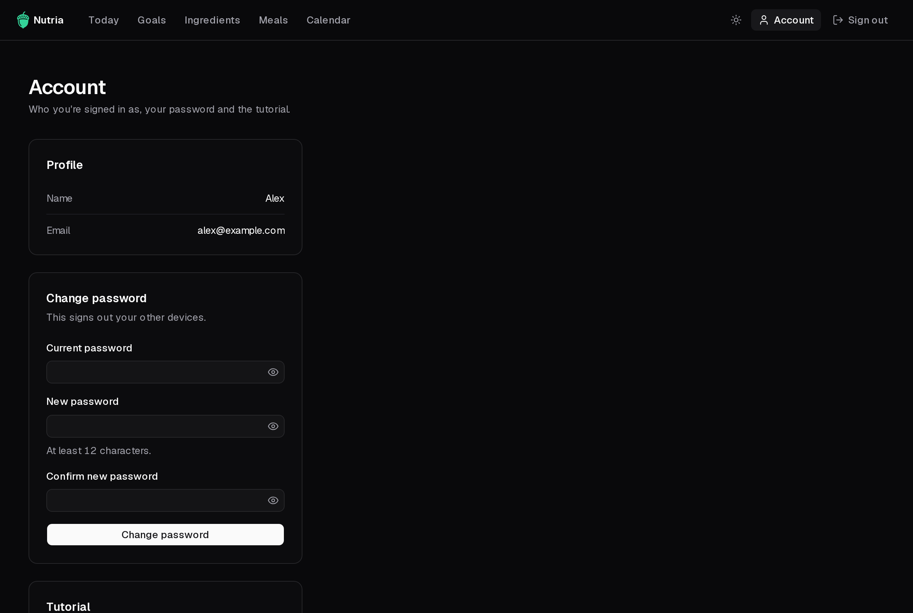

Open **Account** from the top-right of any page.

- **Profile**: the name and email you signed up with.
- **Change password**: enter your current password and a new one of at least 12 characters. Your other devices are signed out.
- **Tutorial**: **Replay the tutorial** opens the [welcome tutorial](/nutria/guide/first-run/#the-welcome-tutorial) again.

## Theme

The sun/moon button in the header switches between dark and light.

## Forgot your password?

Nutria sends no email. Whoever runs the server can [reset it from the command line](/nutria/deployment/password-reset/).
