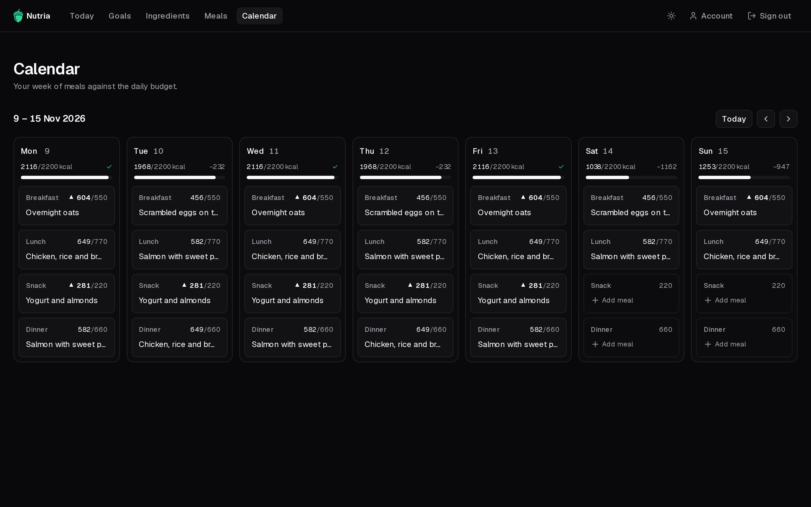
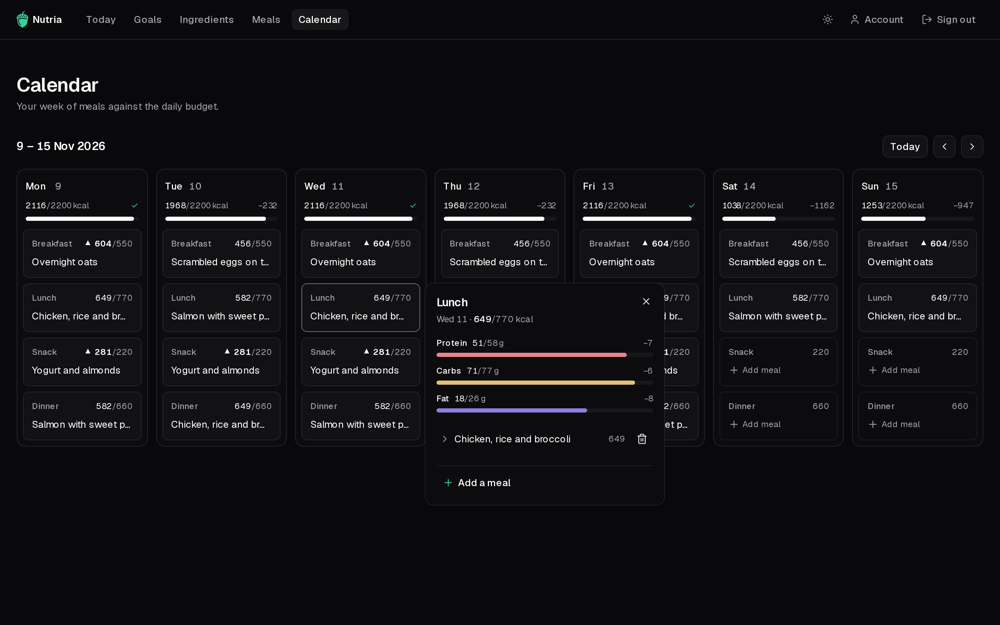

The **Calendar** shows a week, Monday to Sunday, with one card per meal of each day.

## Read the week

- Each **day** shows its planned calories against the daily target, with a ✓ when it's on target or the difference (e.g. `−232`) when it isn't.
- Each **card** shows a meal's planned calories against its share. A `▲` marks one that goes over.
- Use the arrows to move between weeks, and **Today** to come back.

Being over or under isn't an error, just information to plan around.

## Plan a meal

1. Click a card. A panel opens with that meal's protein, carbs and fat against its budget.
2. Pick a meal from your library. Each option shows its macros, and how far over it would take you.
3. To remove a planned meal, use the bin next to it. Expand it to see its ingredients.

A card can hold more than one meal. Past days are read-only.
