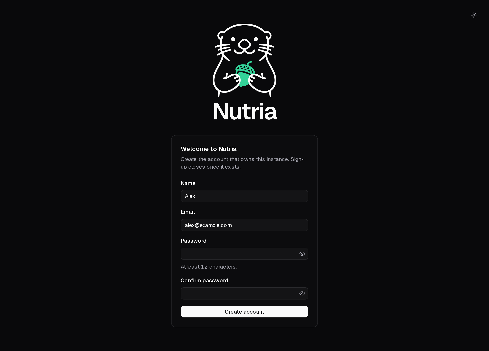
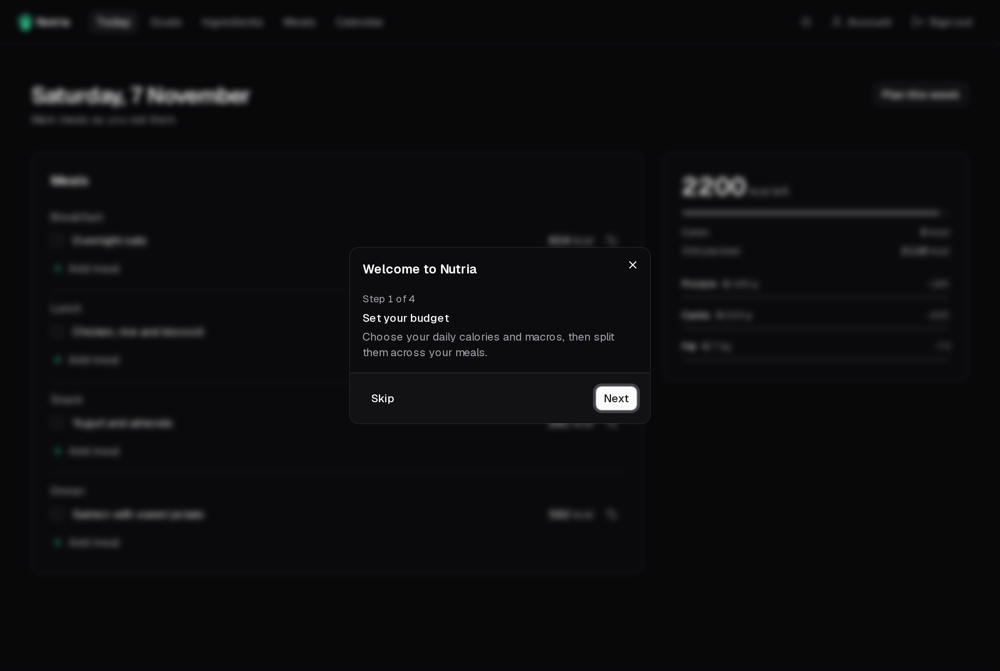

## Create your account

The first time you open Nutria, it asks you to create the account that owns the instance. Enter your name, email and a password of at least 12 characters, then **Create account**.

Nutria has a single account per instance. Once yours exists, sign-up closes for good.

## The welcome tutorial

A short tutorial then opens on the Today page. It walks through the four steps Nutria is built around:

1. **[Set your budget](/nutria/guide/goals/)**: daily calories and macros, split across your meals.
2. **Build your library**: save your [ingredients](/nutria/guide/ingredients/), then combine them into [meals](/nutria/guide/meals/).
3. **[Plan your week](/nutria/guide/calendar/)**: put meals on the calendar.
4. **[Tick off today](/nutria/guide/today/)**: mark what you ate and see what's left.

You can replay it any time from the [Account](/nutria/guide/account/) page.
