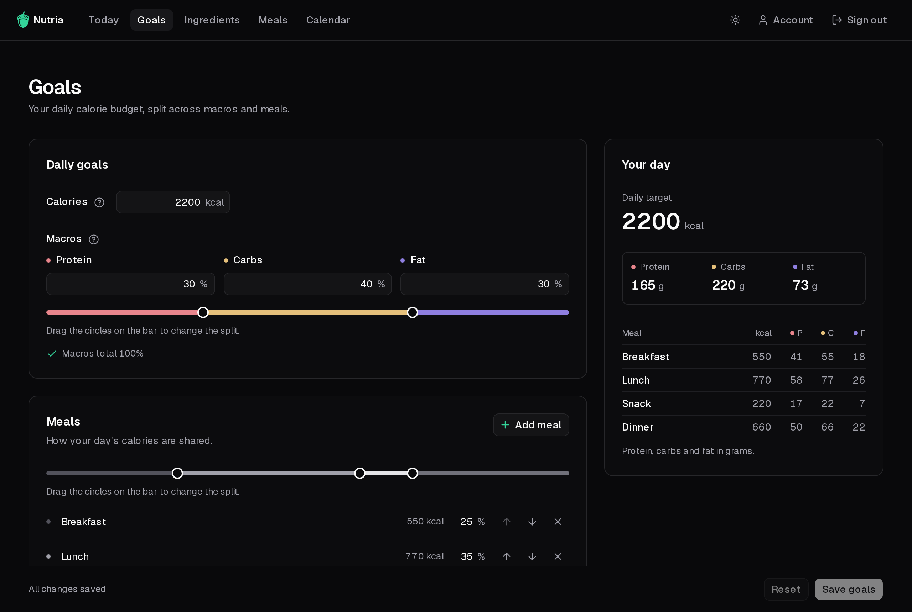

**Goals** is where you set the budget everything else is planned against.

## Daily budget

- **Calories**: your daily target in kcal.
- **Macros**: the share of those calories that comes from protein, carbs and fat. Type the percentages or drag the circles on the bar. They must add up to 100%.

## Meals

Your day is split into meals (Breakfast, Lunch, Snack and Dinner to start with), each taking a share of the daily calories.

- Rename a meal by typing over its name.
- Change its share by typing a percentage or dragging the circles on the bar.
- **Add meal** adds another one; the arrows reorder them and **×** removes one.
- **Split evenly** gives every meal the same share.

Shares must add up to 100%. When they're right, **Set goals** (or **Save goals** later on) saves them.

## Your day

The **Your day** card shows what your goals mean in grams, for the whole day and for each meal. It updates as you type.

:::note[How the grams are worked out]
Protein and carbs give about 4 kcal per gram, fat about 9. So 2,000 kcal at 30% protein is 2000 × 0.30 ÷ 4 = **150 g** of protein. Each meal gets the same numbers scaled by its share: a 40% lunch gets 800 kcal and 60 g of protein.
:::
