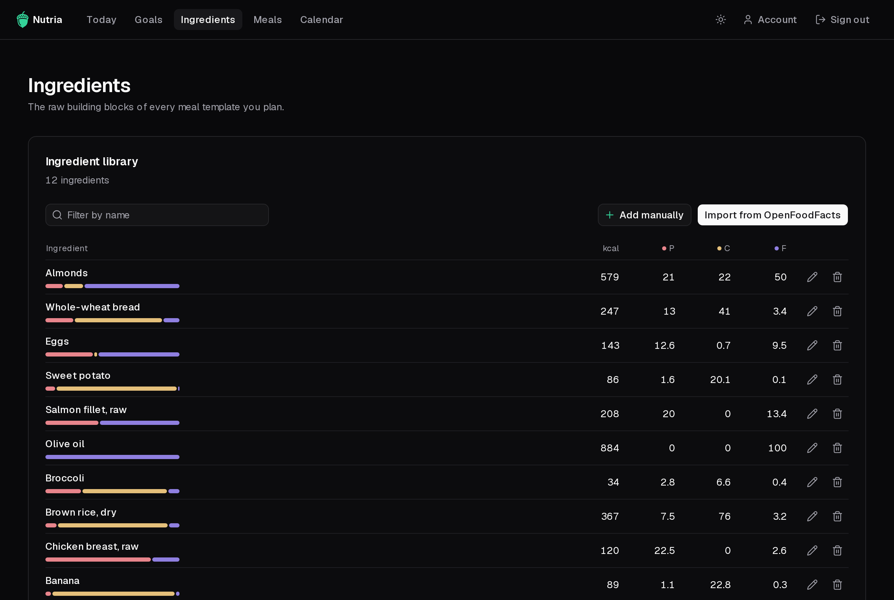
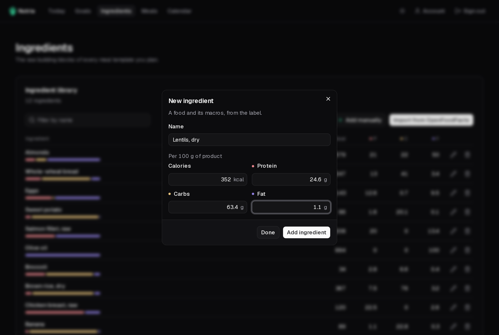

**Ingredients** holds the foods you cook with. Every value is per 100 g.

## Add an ingredient

You have two ways:

- **Import from OpenFoodFacts**: search for a food by name and pick a product. Its calories and macros come straight from the label, so you rarely type them yourself. You can run up to 30 searches a minute; past that, wait a moment and try again.
- **Add manually**: type the name and the calories, protein, carbs and fat per 100 g, from the package label.

## Manage the library

- **Filter** the list by name, and click a column header to sort by it.
- Use the pencil to **edit** an ingredient, or the bin to **delete** it.

:::caution[About food data]
Search results come from [Open Food Facts](https://world.openfoodfacts.org) contributors, under the [Open Database License](https://world.openfoodfacts.org/terms-of-use). The data may contain errors: check the values against the label. Nutria is not medical advice.
:::
