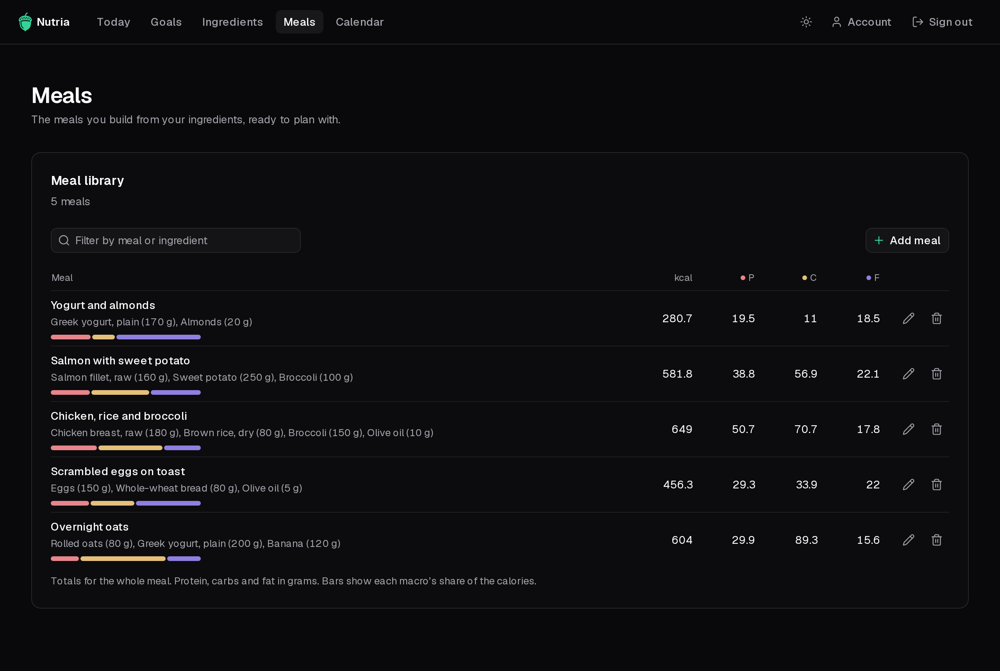
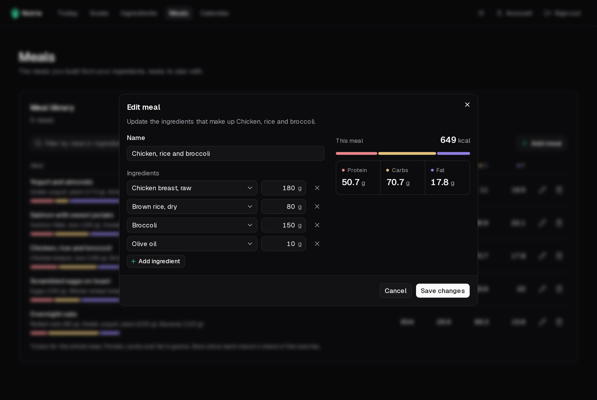

A meal is a named set of ingredients, each with the grams it uses. You build it once and plan it as often as you like.

## Add a meal

1. Click **Add meal**.
2. Give it a name.
3. Pick an ingredient and type its grams. **Add ingredient** adds another row.
4. Check the totals on the right, then **Add meal**.

You need at least one [ingredient](/nutria/guide/ingredients/) before you can build a meal.

## Manage the library

- **Filter** by meal or ingredient name.
- Use the pencil to **edit** a meal, or the bin to **delete** it.
