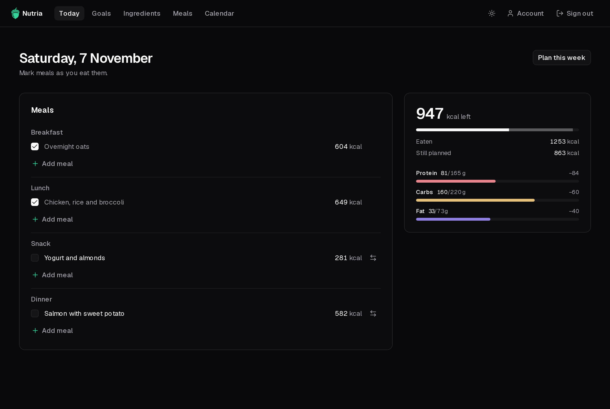
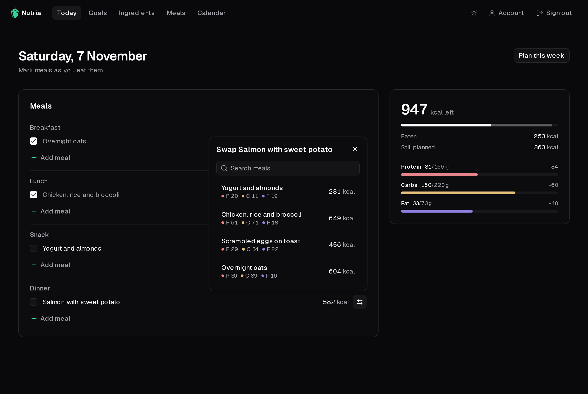

**Today** is the home page. It shows today's planned meals and what's left of your budget.

## Tick off meals

Tick a meal's checkbox when you eat it. Only ticked meals count as eaten.

The card on the right shows:

- **kcal left** for the day.
- **Eaten** and **Still planned** calories.
- Protein, carbs and fat eaten so far, against their targets.

## Ate something else?

- **Swap** (the arrows next to a meal) replaces it with another meal from your library. Each option shows how it would change the slot.
- **Add meal** adds an extra one to a slot.

To plan days ahead, use **Plan this week**, which opens the [Calendar](/nutria/guide/calendar/).
