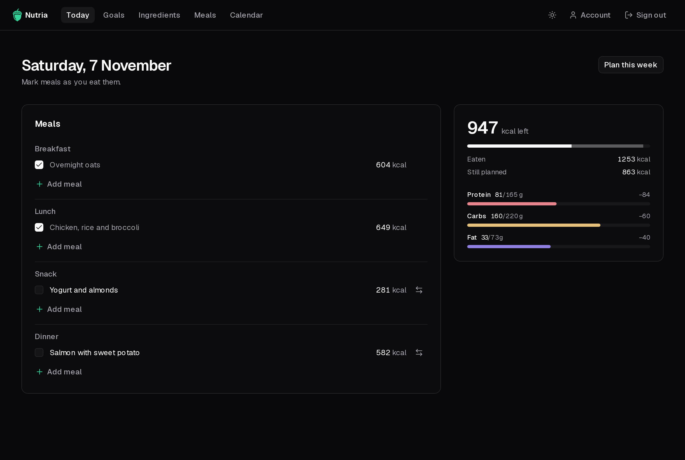

import { CardGrid, LinkCard } from "@astrojs/starlight/components";

## Two sections

<CardGrid>
  <LinkCard
    title="Deployment"
    description="Run your own instance with one compose file, behind a reverse proxy if you like."
    href="/nutria/deployment/self-hosting/"
  />
  <LinkCard
    title="User guide"
    description="Set a budget, build a library of meals, plan your week and tick off today."
    href="/nutria/guide/first-run/"
  />
</CardGrid>

  Nutria is a planning tool, not medical advice. If you manage your diet for a
  health condition, follow your doctor or dietitian.

